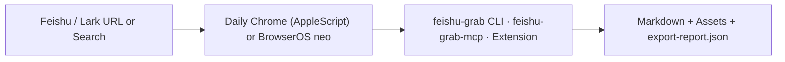

# feishu-doc-grabber

Command-line, MCP, Chrome extension, and macOS exporter for Feishu/Lark documents.
Reuses your everyday Google Chrome or BrowserOS neo session—no cookie exports, remote-debugging ports, or separate sign-in required.

## Workflow



## Install & Quick Start

Requires macOS and Google Chrome (or Node.js `>= 22.12` from source):

```bash
# Homebrew (private repo access via gh auth)
brew tap popcornnnnnnnn/feishu-doc-grabber https://github.com/Popcornnnnnnnn/feishu-doc-grabber.git
brew install popcornnnnnnnn/feishu-doc-grabber/feishu-grab

# Or from local checkout
npm install && npm link
```

Enable **View → Developer → Allow JavaScript from Apple Events** in Chrome once (and approve Terminal Automation if macOS prompts):

```bash
feishu-grab doctor
feishu-grab 'https://example.feishu.cn/wiki/TOKEN' --out ./exports
feishu-grab --current --out ./exports
feishu-grab --list urls.txt --out ./exports
feishu-grab --retry ./exports/export-report.json --out ./exports/retry
feishu-grab search '季度规划' --limit 10 --json
```

> `search` queries documents and wiki pages (never chat messages), preferring BrowserOS neo when running and falling back to an open Chrome Feishu tab.

## Interfaces

| Interface | Entry Point | Notes |
| --- | --- | --- |
| **CLI** | `feishu-grab` / `node cli.mjs` | Export, current tab, search, retry, report (`--help` for options) |
| **MCP Server** | `feishu-grab-mcp` / `mcp/server.mjs` | Exposes `feishu_search` & `feishu_export` over stdio |
| **Chrome Extension** | `npm run build:extension` | Unpacked extension exporting ZIPs ([extension/README.md](extension/README.md)) |
| **macOS App** | `./scripts/build-macos-app.sh` | Self-contained app using isolated Chrome for Testing |

Minimal MCP client config:

```json
{ "mcpServers": { "feishu-grab": { "command": "feishu-grab-mcp" } } }
```

## Integrity & Docs

Every run scores each document as `complete` (exit `0`), `degraded` (`2`), or `incomplete` (`2`) in `export-report.json` alongside `index.html` and `retry-urls.txt`.

- [Detailed Reference](docs/REFERENCE.md) — full CLI flags, isolated browser (`--format pdf|html|capture`), extension, and macOS app notes
- [Integrity Protocol](INTEGRITY.md) · [Test Corpus](TEST-CORPUS.md) · [Plan](PLAN.md) · [Releasing](docs/releasing.md) · [Changelog](CHANGELOG.md)
- Issues: [GitHub Issues](https://github.com/Popcornnnnnnnn/feishu-doc-grabber/issues)
